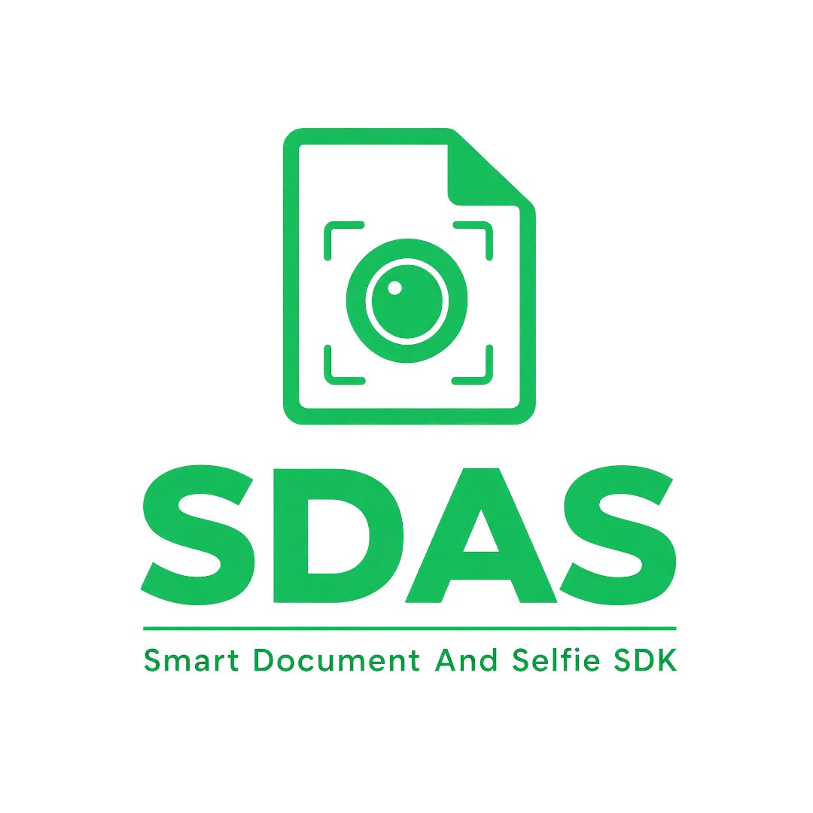
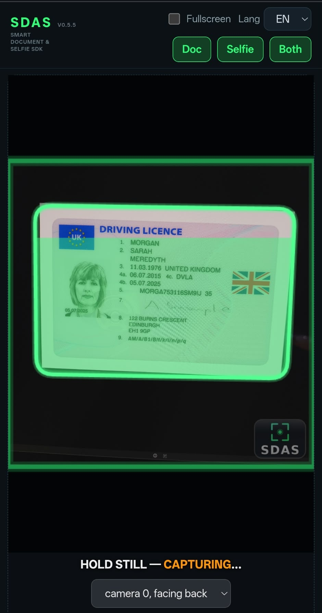
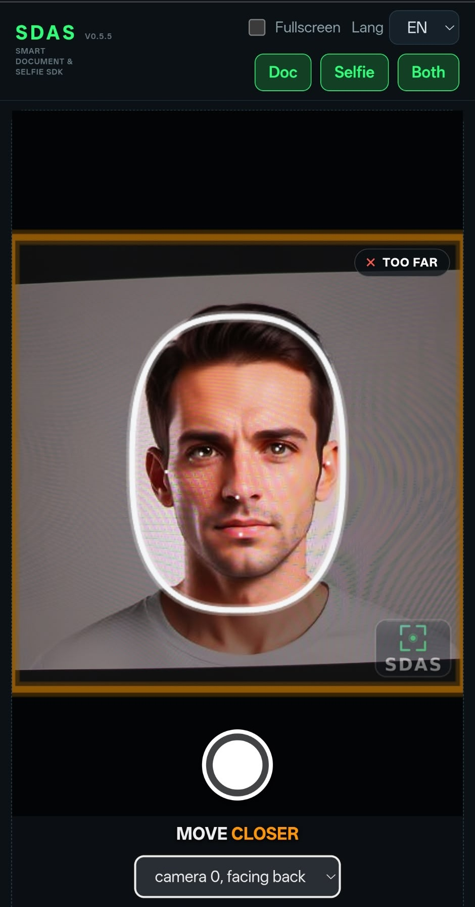
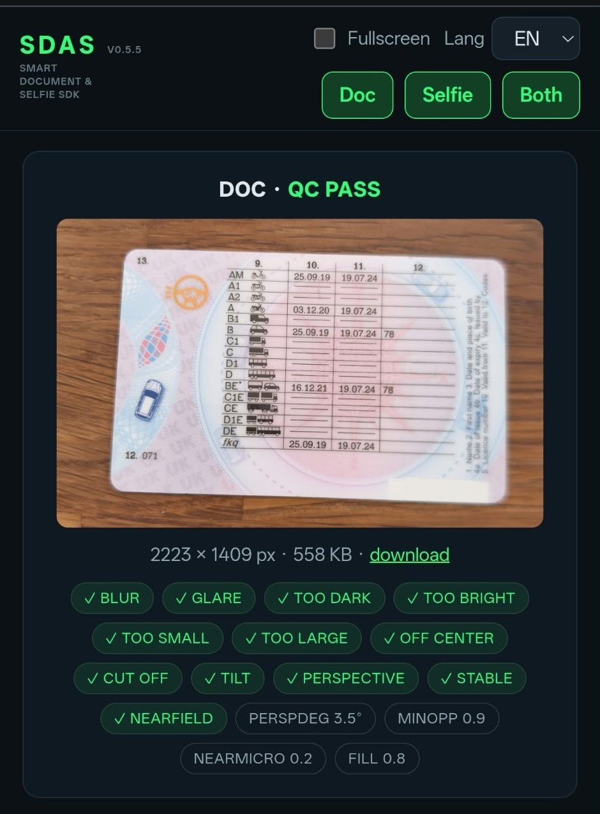

<div align="center">



### Embeddable, fully on-device document + selfie capture for the web

One `<script>` tag and one `SDAS.open()` call. A neural network finds the
document corners, live quality gates coach the user, and you receive JPEG
blobs plus QC verdicts — all computed client-side, nothing uploaded.

[Live demo](https://id.cansahin.net) &nbsp;·&nbsp; [Quickstart](#integration-in-60-seconds) &nbsp;·&nbsp; [Quality gates](#document-capture--live-quality-gates) &nbsp;·&nbsp; [License](#license)


<p>
  
  &nbsp;
  
</p>
<p>
  
</p>

</div>

> **Try it now:** <https://id.cansahin.net> — log in with `demo` / `demo` and
> point your camera at any ID card, or switch to Selfie mode.

SDAS-SDK is an embeddable browser library for identity capture. Point a camera
at an ID document and/or take a selfie: a small on-device neural network finds
the document corners, live quality gates (glare, blur, tilt, perspective,
distance, lighting, stability) coach the user in real time and gate the
auto-capture, and the result — JPEG blobs plus a QC verdict — is handed back
to your code.

Both capture flows (document **and** selfie) ship inside this one library; the
models ride in `sdas-models.pak` and load on demand. The repo is source-free
by design — these are the shipped, tamper-protected distribution artifacts.

---

## What's in this repo

| Path | What it is |
| --- | --- |
| `capture-sdk/` | The **prebuilt SDK**, ready to drop into any web app: `sdas-sdk.js` (the library, global `SDAS`), `sdas-models.pak` (both neural models, the two worker chunks and the watermark, ~1.6 MB), `wasm/engine/` (the three inference runtime variants), `strings.json` (en/de UI text) and the full integrator manual (`capture-sdk/README.md`). |
| `demo-app/` | The reference integration — the same page that runs at the live demo above. |

## Run the demo locally

```bash
git clone https://github.com/dev-c-s/sdas-sdk.git
cd sdas-sdk
python3 -m http.server 8000
# open http://localhost:8000/demo-app/
```

Browsers only grant camera access on secure origins (`https://` or
`localhost`), so the page must be served — opening `index.html` from `file://`
will not work.

---

## Integration in 60 seconds

```html
<script src="./capture-sdk/sdas-sdk.js"></script>
<script>
  const result = await SDAS.open({
    mode: "doc",              // "doc" | "selfie" | "doc+selfie"; omit for a selection pane
    lang: "en",               // "en" / "de"; unknown codes fall back to en
  });
  // result.doc.image is a JPEG Blob — preview it or upload it yourself
</script>
```

That's the whole capture flow: SDAS renders its own full-screen (or embedded)
UI inside a shadow root, acquires the camera, runs the live quality loop, and
resolves the promise when the user accepts a capture.

### What you get back

```ts
type CaptureOutput = {
  image: Blob;      // JPEG
  width: number;
  height: number;
  ok: boolean;      // QC verdict for the captured frame (auto OR manual)
  manual: boolean;
  flags: object;    // QC flags + diagnostics (e.g. perspDeg); {} if none ran
};

type CaptureResults = {
  mode: string;              // the mode that ran
  doc?: CaptureOutput;
  selfie?: CaptureOutput;
};
```

Which keys are populated depends on `mode`:

| `mode` | The promise resolves with |
| --- | --- |
| `"doc"` | `{ mode: "doc", doc: CaptureOutput }` |
| `"selfie"` | `{ mode: "selfie", selfie: CaptureOutput }` |
| `"doc+selfie"` | `{ mode: "doc+selfie", doc: CaptureOutput, selfie: CaptureOutput }` — **both captures in one object** |
| omitted | Landing mode-selection pane; whichever flow the user picks populates its own key |

**How `doc+selfie` runs.** The document leg runs first (rear camera). After
the user reviews and accepts the document capture, the UI switches to the
front camera and the selfie leg starts automatically — no second
`SDAS.open()` call. The promise resolves **once**, after the selfie leg, with
**both** `doc` and `selfie` populated:

```js
const res = await SDAS.open({ mode: "doc+selfie" });
await upload("https://your.api/doc",    res.doc.image);     // rear camera
await upload("https://your.api/selfie", res.selfie.image);  // front camera, mirrored
```

- Each leg carries its **own independent QC verdict** — `ok`, `manual` and
  `flags` describe that capture only. `res.doc.ok` tells you nothing about
  `res.selfie.ok`.
- Selfie captures are additionally clamped to a **1920 px long edge**, even
  when `maxEdgePx` is set higher.
- Each leg has its own retry loop (`Retry` re-captures the current leg);
  the flow only advances on accept.
- There is no user-facing cancel: a new `SDAS.open()` destroys the active
  flow, and its promise rejects with `{ cancelled: true }`.

`image` is a `Blob` in memory — create `URL.createObjectURL(result.doc.image)`
to preview it, or upload/`FormData` it directly. Nothing is uploaded by the
SDK itself. Selfie captures are mirrored to match the live framing preview
(WYSIWYG — what the user framed is what they get).

If the capture engine fails to initialize (or hangs), the promise **rejects**
with an error carrying `code: "model_failed"` and the overlay is torn down —
handle the rejection.

### Options

| Key | Type | Default | Meaning |
| --- | --- | --- | --- |
| `mode` | `"doc" \| "selfie" \| "doc+selfie"` | omitted → selection pane | Capture flow. `doc+selfie` runs the document first, then the selfie automatically. |
| `lang` | `string` | `"en"` | UI language. Unknown code falls back to `en`. |
| `strings` | `Record<string, string>` | `{}` | Per-key string overrides, highest precedence over `lang`. |
| `fullscreen` | `boolean` | `true` | Fixed full-viewport overlay. `false` requires a `container`. |
| `container` | `HTMLElement \| string` | none | Mount target (element or selector) when embedding in a page region. Wins over `fullscreen` if both are given. The host fills 100% of the container but enforces a `min-height` of 480px — a container with auto height would otherwise render a zero-height capture UI. |
| `manual` | `number \| boolean` | `false` | `N` = seconds after the camera goes live until the shutter appears; `true` = shutter from the start. |
| `aiCapture` | `boolean` | `true` | `false` disables auto detection — manual shutter from the start. |
| `qualityChecks` | `boolean` | `true` | `false` skips the QC gates (a stable quad is still required for auto capture). |
| `maxEdgePx` | `number` | `4096` | Long-edge clamp at accept, aspect preserved (JPEG 0.9). No re-encode under the limit. |
| `cameraSelection` | `boolean` | `true` | Show the in-capture camera dropdown so the user can switch cameras. Set `false` for a locked-down UI (the automatic camera choice is unaffected). |

> `capture-sdk/README.md` is the complete integrator manual — manual-capture
> semantics, camera-permission behavior, i18n authoring, file layout and
> serving advice.

---

## Advanced features

### Document capture — live quality gates

Auto-capture fires only when **every** gate holds. While a gate fails, the
user sees a single, prioritized on-screen instruction; failing
*environmental* checks also appear as compact badges in the viewfinder. All
gates use enter/exit **hysteresis** so prompts never flicker at the
threshold.

| Gate | What it verifies | Live coaching (verbatim UI text) |
| --- | --- | --- |
| Distance / minimum size | The document must fill an **adaptively derived** share of the frame — clamped between 62% and 85%, with comfort and focus caps so the user is never pushed past what a natural handheld hold delivers | `MOVE CLOSER` / `MOVE BACK` |
| Too close (defocus) | Oversized, unsharp cards are rejected — browser cameras cannot focus at very close range. A second, higher-resolution defocus check runs at capture-confirm time | `TOO CLOSE — MOVE FARTHER` |
| Blur | Edge sharpness on the rectified card | `BLURRY — HOLD STILL` |
| Glare | Three-tier glare analysis of the rectified card (white clip cores, bright sheen, dense hotspots) | `TILT AWAY FROM GLARE` |
| Perspective / skew | Corner-angle deviation from 90° plus an opposite-edge foreshortening check — tuned to accept natural in-hand capture, reject genuinely skewed locks | `FACE CARD HEAD-ON` |
| Tilt (roll) | Card held level | `HOLD IT LEVEL` |
| Centering | Document position within the frame | `CENTER THE CARD` |
| Cut-off | Whole card inside the frame | `MOVE CARD INTO VIEW` |
| Aspect plausibility | The card must measure plausibly for its orientation, so a wrong surface locked by the detector fails instead of capturing | (verdict gate) |
| Lighting | Dark / too-bright scene checks | `TOO DARK — ADD LIGHT` / `TOO BRIGHT` |
| Document presence | A card must actually be detected before the other gates evaluate | `NO CARD DETECTED` |

**Corner stability** — per-corner adaptive smoothing, tie-hold coasting over
ambiguous detections, re-acquisition confirmation and glitch bridging: the
corner overlay never yanks between frames and the hold never restarts on a
momentary decode glitch.

**Progress-fill hold** — instead of a numeric countdown, the corner wireframe
fills bright green while all gates hold, with graded drain-back on failure
(single tremors don't zero the progress). A moved document is caught at
review.

**Thermal pacing** — on throttling phone SoCs, frames are paced so clocks
recover between analysis rounds, keeping the sustained analysis rate healthy.

### Selfie capture

Face detection with 6-point landmarks runs on the same on-device runtime as
the document model — no second engine, no extra download.

| Gate | What it verifies | Live coaching (verbatim UI text) |
| --- | --- | --- |
| Face + centering | Face detected and centered inside an on-screen **head-mask guide** | `CENTER YOUR FACE` / `NO FACE DETECTED` |
| Distance | Face height within the mask guide's band | `MOVE CLOSER` / `MOVE BACK` |
| Pose | Yaw, pitch and roll within calibrated limits | `TURN HEAD STRAIGHT` / `LOOK STRAIGHT AT CAMERA` / `HOLD HEAD LEVEL` |
| Blur | Scale-invariant sharpness check on the face crop | `BLURRY — HOLD STILL` |
| Lighting | Dark / too-bright scene checks | `TOO DARK — ADD LIGHT` / `TOO BRIGHT` |
| Stability | Head still before the capture fires | `HOLD STILL` |

Output is **mirrored** to match the live preview (WYSIWYG).

### Runtime & integration features

- **Fully on-device inference** — models run in a worker; no server, no API
  keys, nothing leaves the page.
- **WebGPU with automatic fallback** — GPU acceleration is verified by a
  warmup probe; otherwise the runtime steps down through wasm variants, and
  only the selected variant is ever downloaded.
- **Shadow-DOM isolation** — fullscreen overlay or embedded container mode;
  styles sealed in both directions.
- **Warm camera stream** — doc ↔ selfie switches reuse the live stream; no
  re-prompts on same-camera switches.
- **Camera selection** — optional in-capture dropdown; virtual camera devices
  are filtered out automatically.
- **Manual capture** — timed or always-on shutter that bypasses the gates,
  returning the frame's QC verdict with the image.
- **`maxEdgePx` output clamp** — long-edge downscale at accept, no double
  compression under the limit.
- **i18n** — English and German built in, per-key string overrides; adding a
  language is one JSON section, no rebuild.
- **No server requirements** — no COOP/COEP headers, no special MIME config;
  serve it like any static site.
- **Tamper protection** — the shipped binaries are integrity-verified to
  protect against tampering; use them as distributed, without modification.
- **Diagnostics included** — every capture returns its QC `flags` object
  (gate verdicts + degree measurements), ready for your own analytics.

---

## Requirements

- **HTTPS is mandatory** — browsers only grant camera access (`getUserMedia`)
  on secure origins (`https://` or `localhost`).
- Modern **Chrome, Edge, Firefox and Safari** (including iOS). WebGPU is
  optional and used when available; the wasm fallback covers everything else.
- **No special server headers** — no COOP/COEP, nothing beyond serving `.js`
  as JavaScript. `sdas-models.pak` is fetched as a binary blob and benefits
  from gzip/brotli like any static asset.
- Keep the `capture-sdk/` folder contents together and the folder name stable
  relative to your page — the SDK resolves every asset relative to the script
  URL. Full layout: `capture-sdk/README.md`.

## Privacy

SDAS-SDK runs **fully on-device**. All inference happens in the browser, and
each capture — image plus QC verdict — is returned directly to the calling
page. Nothing is uploaded, stored or transmitted: apart from loading its own
static assets from your page's origin, the SDK makes no network requests.

## License

The repo contents are distributed under the **PolyForm Noncommercial License
1.0.0** — free to use, study, modify and share for any **noncommercial**
purpose. **Commercial use requires a separate license from the author** —
contact: <licensing@cansahin.net>.

```
Required Notice: Copyright 2026 dev-c-s (https://github.com/dev-c-s)
```

The full license text is in [LICENSE](LICENSE).

**Third-party components:** the compiled runtime in `capture-sdk/wasm/engine/`
is derived from [LiteRT](https://github.com/google-ai-edge/LiteRT) (formerly
TensorFlow Lite), © the LiteRT Authors, licensed under the Apache License 2.0
— see the attribution section of `capture-sdk/README.md`.
